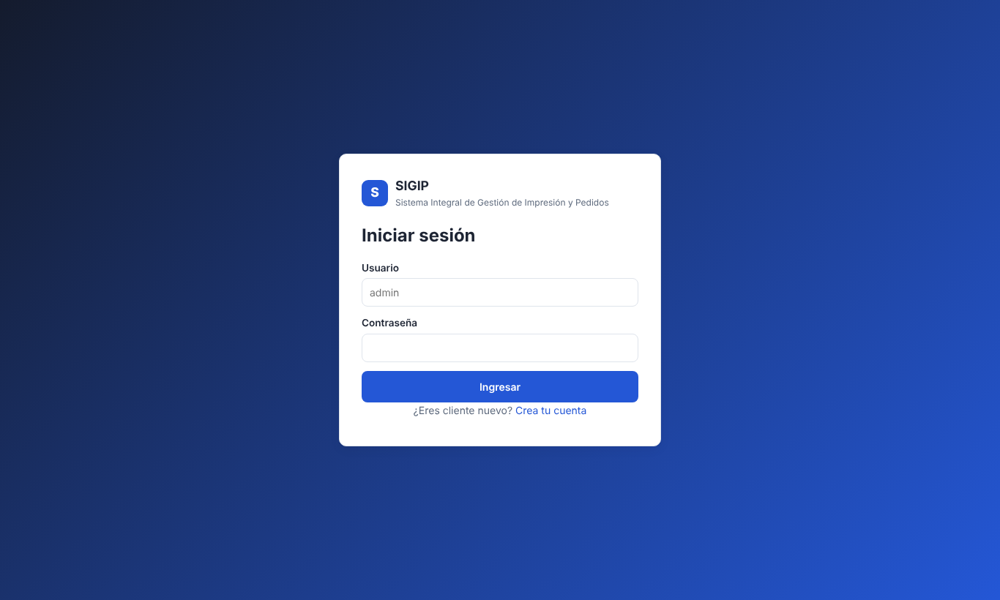
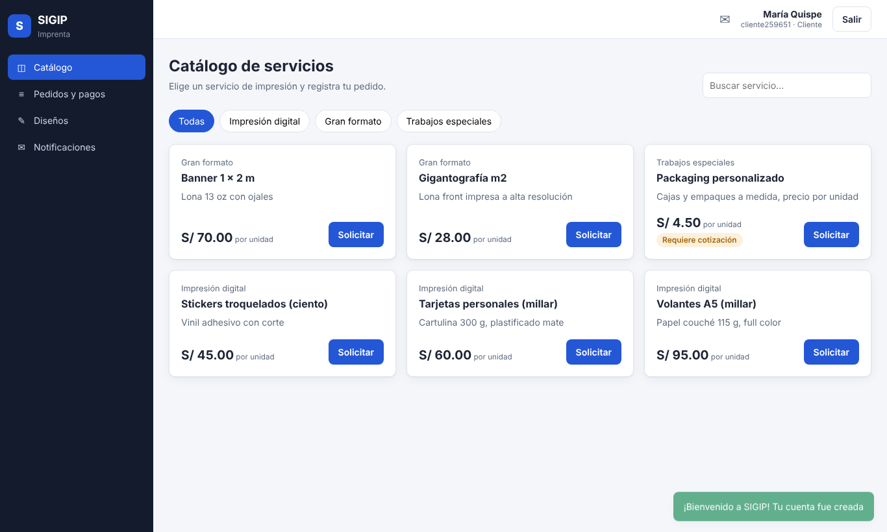
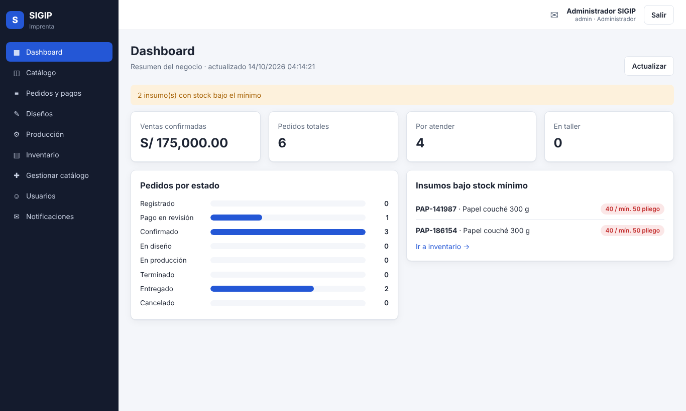
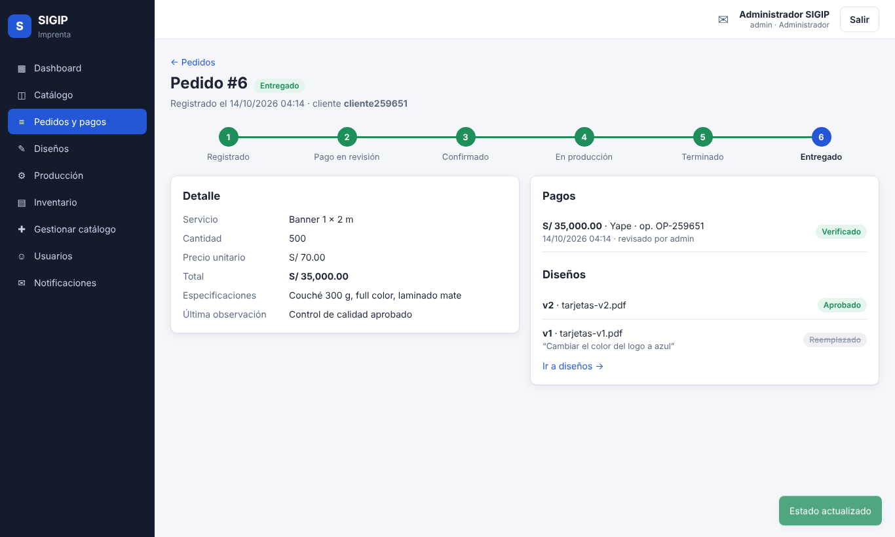
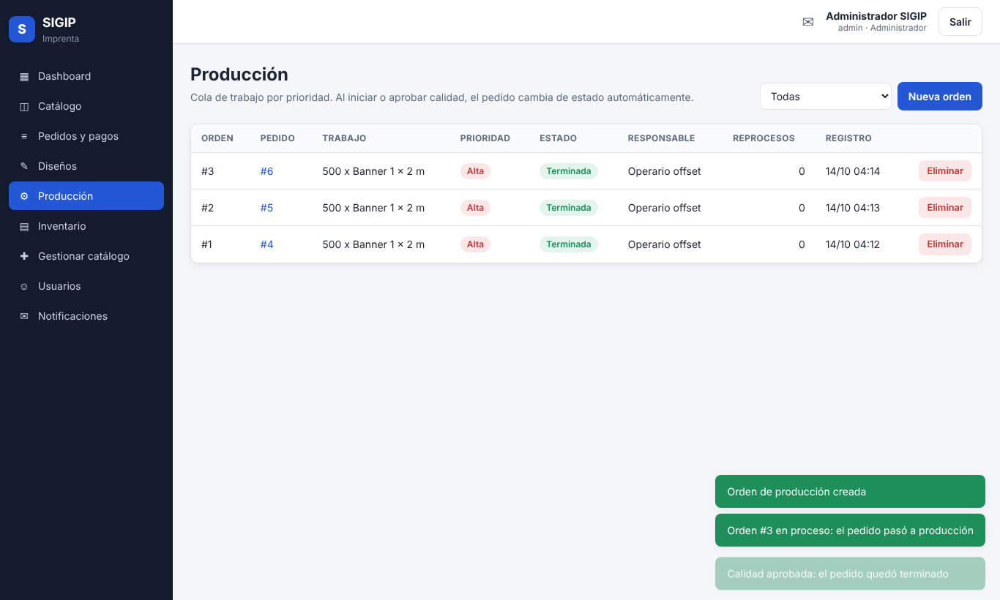
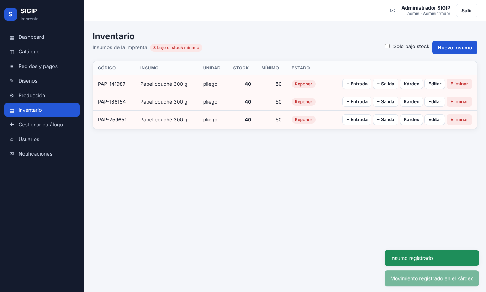

# Frontend Angular

Aplicación web de SIGIP para los dos actores del sistema: el **cliente** de la imprenta y el **administrador**.
Consume los microservicios **solo a través del API Gateway** (`:8090`), igual que Postman.

## Tecnología

| Elemento | Elección | Motivo |
|---|---|---|
| Framework | Angular 21 (componentes *standalone*) | Lo pide el curso; tipado fuerte con TypeScript |
| Estado de pantalla | *Signals* (`signal`, `computed`) | Detección de cambios simple, sin Zone.js |
| HTTP | `HttpClient` + interceptor funcional | Un solo lugar agrega el JWT y maneja el 401 |
| Formularios | Reactive Forms (login, registro) y `ngModel` (modales) | Validaciones en el cliente antes de llamar a la API |
| Rutas | Lazy loading con `loadComponent` + guards | Cada pantalla se descarga solo cuando se usa |
| Pruebas | Vitest (14 pruebas) | Servicio de sesión, interceptor, guards, pipe y manejo de errores |
| Producción | nginx en Docker | Sirve los archivos y reenvía `/api` al gateway |

## Estructura

```
frontend/src/app
├── core/                    lógica sin pantalla
│   ├── models.ts            interfaces = DTO del backend
│   ├── auth.service.ts      login, registro, sesión (token en localStorage), rol
│   ├── auth.interceptor.ts  agrega "Authorization: Bearer"; si llega 401 cierra la sesión
│   ├── guards.ts            authGuard, adminGuard, invitadoGuard
│   ├── notificador.service  toasts y traducción del ApiError del backend
│   └── services/            un servicio por microservicio (SRP)
│       catalogo · ventas · diseno · produccion · inventario · notificaciones · reportes · usuarios
├── layout/shell             menú lateral según el rol, campana de no leídas, salir
├── shared/                  modal, etiqueta de estado (badge), pipe "etiqueta"
└── pages/                   una carpeta por pantalla
```

Cada servicio de Angular corresponde a un microservicio: `CatalogoService` → `catalog-service`,
`VentasService` → `sales-service`, etc. Así una pantalla no conoce URLs ni detalles HTTP.

## Pantallas por rol

| Pantalla | Cliente | Admin | Microservicio |
|---|---|---|---|
| Login / registro | ✔ | ✔ | auth |
| Catálogo y solicitud de pedido | ✔ | ✔ | catalog, sales |
| Pedidos y detalle (avance, pagos, diseños) | sus pedidos | todos + filtro, verificar pago, cambiar estado | sales, design |
| Diseños | aprobar / observar | publicar versiones, editar, eliminar | design |
| Notificaciones (campana con no leídas) | las suyas | todas + aviso manual | notification |
| Dashboard | | ✔ | report |
| Producción (cola, iniciar, control de calidad) | | ✔ | production |
| Inventario (insumos, entradas/salidas, kárdex) | | ✔ | inventory |
| Gestionar catálogo (categorías y servicios) | | ✔ | catalog |
| Usuarios y roles | | ✔ | auth |

El menú solo muestra lo que el rol puede usar y `adminGuard` bloquea las rutas de administrador. Esto es
comodidad de interfaz: **la seguridad real está en el backend** (`@PreAuthorize` responde 403 aunque alguien
llame a la API directamente).

## Cómo se conecta con el backend

```
Navegador ──► nginx (frontend :4200) ──/api/*──► API Gateway :8090 ──lb://──► microservicios
```

- **Desarrollo** (`npm start`): `environment.development.ts` apunta a `http://localhost:8090`. El navegador
  llama directo al gateway, que responde las cabeceras CORS para `http://localhost:4200` (`CORS_ORIGINS`).
- **Docker / nube**: `environment.ts` usa `/api`. nginx (`nginx.conf.template`) reenvía `/api/*` al gateway
  (`API_GATEWAY_URL`), así el navegador ve un solo origen y no necesita CORS.

Los errores del backend llegan siempre con el formato `ApiError` (`status`, `error`, `message`) de
`sigip-common`; el frontend muestra `message` en un toast rojo (por ejemplo, "Solo se puede modificar un
pedido en estado REGISTRADO").

## Ejecutar

```bash
# Con todo el sistema
docker compose up -d --build        # frontend en http://localhost:4200

# Solo el frontend (con el backend ya levantado)
cd frontend
npm install
npm start                           # http://localhost:4200
npm test                            # 14 pruebas unitarias
npm run build                       # genera dist/frontend/browser
```

Usuario inicial: `admin` / `Admin12345` (o el valor de `SIGIP_ADMIN_PASSWORD`). Los clientes se registran
desde la pantalla de login.

## Prueba de punta a punta realizada

Con `docker compose` levantado se recorrió en el navegador (Playwright) el flujo completo, sin errores en
consola: registro de cliente → pedido → pago → verificación (admin) → diseño v1 observado → v2 aprobado →
orden de producción → inicio → control de calidad → entregado → salida de inventario hasta bajo stock →
notificaciones del cliente (6 avisos por RabbitMQ) → el cliente no puede entrar a `/inventario`.
Se probó igual en modo desarrollo (`npm start`, llamando al gateway con CORS).

## Capturas

| | |
|---|---|
|  |  |
|  |  |
|  |  |
